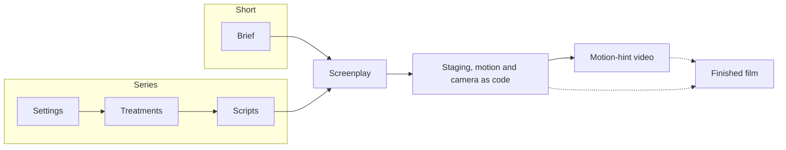

# AutoMovie

[](https://github.com/samchon/automovie/blob/master/LICENSE)
[](https://www.npmjs.com/package/automovie)
[](https://github.com/samchon/automovie/actions?query=workflow%3Abuild)

Your coding agent writes a film's screenplay and programs its staging, motion and camera; AutoMovie computes that code into the same frames every time, as a motion hint for video diffusion or as a film rendered directly.

- **Made for the motion hint.** Every part serves one output: the best hint a video diffusion model can be given of who is where, what they do, what they touch and when.
- **Simple rendering, precise motion.** People are a polygon man and sets are coarse meshes on purpose; the accuracy goes into the performance, its contacts and its timing.
- **Everything is code.** The agent writes the screenplay as text and the film as TypeScript against typed packages, so a motion is a module: tested once, accepted on stills, reused by any scene and any body.
- **The same frames every time.** The engine computes each frame from the code and a seed, so a defect is found on a still, corrected at its cause and recomputed, never regenerated.
- **No LLM and no server inside.** You bring the coding agent, the image or video models a production uses, and the machine that renders.

## What AutoMovie is

AutoMovie is a set of npm packages and a scaffold for a production, the project of one film. `automovie create` installs the scaffold: an `AGENTS.md` and `CLAUDE.md`, the skills that tell the agent how a film is researched, written, programmed, rendered and reviewed, the contracts its work answers, and an empty Viewer. You open it in any coding agent that reads those files and direct it in natural language: what to make, what you fix, what you delegate. The agent records your decisions in `PROJECT.md` and `docs/instructions`, decides delegated choices itself, and asks only when a fixed condition conflicts or an undelegated decision blocks it.

### Simple rendering, precise motion

A motion hint tells a video model where each person is, what they do, what they touch and when; the model supplies the surfaces. So a production draws every person as a polygon man, plain primitives over the joints of the body `@automovie/human` prepares, and every other subject as the simplest form that identifies it, and detail is an option a delivery switches on, never something a scene depends on. A polygon man has no face, so the screenplay writes attention as the turn of a head and torso, and what the hint cannot carry reaches a generated film through reference images and the prompt.

The motion is where the accuracy goes. Every movement is a goal for hands, feet and hips on their targets, a fist on the struck region, each foot on the floor at its step, both hands on a grip, scaled to the body that performs it, with contacts and reactions computed by the engine.

### Motion as code

The cast, sets, performance, staging and camera are TypeScript the agent writes against `@automovie/interface`, the typed authoring AST, and `@automovie/motions`, the vocabulary of human actions. An action is a law that brings the body onto its targets, so one chain of actions fits people of different stature and proportion, and an action can be interrupted mid-motion. A production composes each person's performance from that vocabulary, writes a law of its own only for what the vocabulary lacks, tests it against its study, and accepts every module in catalog cases on stills before a scene uses it. A scene then only composes accepted modules, and a defect the scene shows is fixed in the module and its case, never patched in the scene.

### The motion hint

The hint reaches a video model as a hint video and the control channels that model takes, such as pose, depth, normal, outline or a semantic mask, rendered from the same performance and aligned frame for frame. Some models restyle the hint video, some read it as a reference for motion and camera, and open models follow pose or depth passes exactly. An accurate hint does not decide what the model makes of it, so generated takes are inspected against the hint at matched frames, and the agent's report says what it verified and what only you watched.

### Inspect and correct

`@automovie/engine` computes what each frame contains: poses within range of motion, sampled motion, staging and cuts, physics, light and sound. The same input produces the same frames in the browser Viewer, in a Node frame capture that needs no GPU, and in the exported video, so the agent judges a film on stills at the seconds that matter, every contact and cut included, fixes the module at fault, and judges the correction at the same second and camera. You watch the playback and listen, which the agent cannot.

### No LLM and no server

AutoMovie contains no LLM and no server. The agent is yours; the engine, the motion vocabulary and the Viewer are libraries the production imports; an image or video model, when a production uses one, is reached through the provider you choose and record in `PROJECT.md`; the render runs on your machine through Chrome and FFmpeg.

## How a film is made



A short runs brief → screenplay and a series settings → treatments → scripts → screenplay; in a workspace the production's folder, `movies/shorts/<name>` or `movies/series/<name>`, fixes the route. The agent follows one chain, and each link cites the decisions of the link above it, so no scene exists without a written basis and no decision goes unrealized. A series inspects, repairs and independently reviews each layer before the next starts; a short drafts its brief, screenplay and film together, then answers its checklists and takes one independent review. A gap found downstream is repaired in the layer that owns it.

The agent studies every practice and style the film shows, a sport, a craft, a crowd's conduct, a camera style, when a decision first needs it, starting from the density and distribution of the practice as it is really performed, and keeps the sources under `references/`, because a law written without a study invents the practice.

### A short: brief, then screenplay

A short is a film of a few minutes whose events fit one screenplay. Its brief is a minimal canon: only the decisions about its people, places and recurring props that several scenes must keep true, and a generated film's look, one file per subject with an anchor per decision that the screenplay cites. Several shorts can share one brief and one world.

### A series: settings, treatments, scripts, then screenplay

A series, a feature or an episode spans causes, setups and payoffs over many scenes, so it is written in four layers. Settings are the facts about the world and its people, places and objects, with their baseline states, relationships and what each one knows. Treatments decide the events: causes, choices, consequences, setup and payoff, and when the audience learns what. Scripts partition the events into scenes and execute each one: dialogue, action, reactions, stage, light, sound and view.

### The screenplay

On both routes the screenplay composes what the audience sees and hears, beat by beat in one file per scene, with each action named as one the installed motion vocabulary performs or as a law the research describes. It is the last place a decision is made; code only realizes it.

### Staging, motion and camera as code

The agent builds the cast and sets as coarse entities, composes each person's performance from actions such as walk, approach, look, gesture, sit, pick up, punch and guard, and writes a law of its own, with its study and tests, for an animal, a vehicle, a crowd moving as a mass, a camera or a light. Each main scene is composed segment by segment from the accepted modules and staged for the camera, and the sound of each shot is described for the video prompt.

### The motion-hint video

The production's Viewer plays, pauses and seeks the same performance the export uses, a capture draws stills of any second from any view through the same draw function the render uses, and the render exports the film through headless Chromium and FFmpeg on your machine. The agent assembles the film in the screenplay's order, renders the control channels from the same performance, inspects stills from the source and from the encoded file, and hands off the fixed inputs, the commands that reproduce it and the remaining limits. The whole hint is complete when every main scene is programmed and the whole video is assembled; stills or pilot clips do not complete it.

### A finished film

A production can end at the screenplay or the hint, or go on to a film: rendered directly in 3D from the same code, or generated by a video model from the hint. For a generated film the agent chooses the model with you, plans each shot within the model's limits, writes the prompts, and inspects and assembles the accepted takes.

The generated production [README](https://github.com/samchon/automovie/blob/master/packages/template/scaffold/production/README.md) owns these steps, their commands and the project layout.

## Setup

### A single production

```bash
npx automovie create <directory>
cd <directory>
pnpm install
```

Open the directory in your coding agent and tell it what to make. The new production holds the instructions, contracts, configuration and an empty Viewer, and no film.

### A workspace

```bash
npx automovie create <directory> --workspace
cd <directory>
pnpm install
pnpm automovie add shorts/<name>
pnpm install
```

A workspace keeps several productions under one `AGENTS.md`, `CLAUDE.md` and `.agents/skills`, with its own packages for code they share. Open the production's directory in your coding agent as above.

## Commands

```text
npx automovie create <directory> [--workspace] [--name <name>] [--force]
pnpm automovie add <shorts|series>/<name> [--name <name>] [--force]
automovie capture --module <file> [--props <json>] [--backend software|gpu] [--out <dir>] [<request>]
automovie capture --file <video> [--out <dir>] [<request>]
automovie render --module <file> [--subject <name>] [--props <json>] [--out <dir>] [--backend software|gpu]
automovie review --url <inspector address> --seconds <s> [--out <dir>]
```

### create

`create` installs a single production, a pnpm project whose `pnpm-workspace.yaml` holds the catalogs that pin its dependencies. With `--workspace` it installs a pnpm workspace root instead, with a `pnpm-workspace.yaml` whose members are `movies/shorts/*`, `movies/series/*` and `packages/*` and whose catalogs pin every production dependency. The package name is `--name` when given and otherwise comes from the directory name.

### add

`add` runs at a workspace root, the directory holding `pnpm-workspace.yaml`. `add shorts/<name>` writes a production into `movies/shorts/<name>` and `add series/<name>` into `movies/series/<name>`; `pnpm install` again links it. The production takes its dependencies from the root's catalogs and its skills from the root's `.agents/skills`.

`create` and `add` refuse a non-empty target unless `--force` is given, which replaces files at the same paths.

### capture

`capture` runs in a production, which `pnpm run capture` does with `--module src/subjects.ts`. It builds a draw-only page for the module's subjects with the production's Vite, draws every planned still in headless Chromium through `@automovie/render`'s draw function, with SwiftShader unless `--backend gpu`, and writes stills, contact sheets and `record.json` into `--out` or `media/capture/<subject>`. `--props <json>` passes a module the data its subjects are built from, and `--file` captures a video file's own frames with FFmpeg from `FFMPEG_PATH` or `ffmpeg-static` instead. The remaining options are the capture request: `--subject`, the seconds, views, passes, inspection and rounds. `npx playwright-core install chromium-headless-shell` installs the browser, and `CHROME_PATH` selects another. It exits 1 when a cell could not be drawn.

### render

`render` runs in a production, which `pnpm run render` does with `--module src/subjects.ts`. It draws every frame of one subject, `--subject` or the module's only one, through the same draw page and function as `capture`, and encodes them once with FFmpeg into `film.mp4` with `render-report.json` beside it, in `--out` or `media/automovie/<subject>/videos`. `--props <json>` passes a module the data its subjects are built from.

### review

`review` records real-time playback of the production's running inspector page, `pnpm run dev`, at `--url` for `--seconds` of wall time after pressing its Play button, into a video with `playback.json` of the readings and page errors, in `--out` or `media/automovie/review`. `npx playwright-core install ffmpeg` provides the recorder. It exits 1 when the page reported a script error.

## Packages

| Package | Purpose |
| --- | --- |
| [`automovie`](https://github.com/samchon/automovie/tree/master/packages/cli) | The CLI that installs and updates the scaffold |
| [`@automovie/interface`](https://github.com/samchon/automovie/tree/master/packages/interface) | The authoring AST: the types a coding agent fills in |
| [`@automovie/engine`](https://github.com/samchon/automovie/tree/master/packages/engine) | Deterministic validation and computation of everything a frame contains |
| [`@automovie/human`](https://github.com/samchon/automovie/tree/master/packages/human) | The body of a person, its skeleton and contact profile, generated by code from typed parameters (being rebuilt) |
| [`@automovie/motions`](https://github.com/samchon/automovie/tree/master/packages/motions) | Human actions, such as walk, sit and pick up, as deterministic laws scaled to the body |
| [`@automovie/archetypes`](https://github.com/samchon/automovie/tree/master/packages/archetypes) | Coarse seeded models of the things people hold, use, sit on, ride and fight with, each with the contacts an action reads |
| [`@automovie/ingest`](https://github.com/samchon/automovie/tree/master/packages/ingest) | Deterministic import of glTF, GLB, VRM, WAVE and PPM inputs |
| [`@automovie/recovery`](https://github.com/samchon/automovie/tree/master/packages/recovery) | Curves recovered from a reference mesh, and geometry rebuilt from them |
| [`@automovie/viewer`](https://github.com/samchon/automovie/tree/master/packages/viewer) | Interactive Three.js display: canvas mount, playback, snapshot saving and transport controls |
| [`@automovie/render`](https://github.com/samchon/automovie/tree/master/packages/render) | Three.js scene building, passes, inspection and the polygon man, plus frame schedules, edit timelines and encoder plans, with capture and encoding supplied by the calling program |
| [`@automovie/evidence`](https://github.com/samchon/automovie/tree/master/packages/evidence) | Checks that a production's code and writing answer their checklists |
| [`@automovie/template`](https://github.com/samchon/automovie/tree/master/packages/template) | The scaffold every production starts from |

## License

[MIT](https://github.com/samchon/automovie/blob/master/LICENSE)
