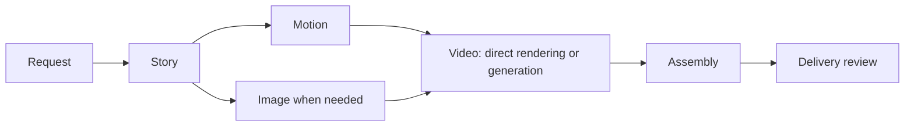

# Production workflow

The order of a production's tasks, and what each hands to the next.

## At a glance

For a finished film, the tasks connect like this:

[Story](../story/SKILL.md) receives the request and adopted facts, and its screenplay states what the audience sees and hears: events, lines, cuts and sound. [Motion](../motion/SKILL.md) receives the screenplay and [simple 3D subjects](../development/entities.md#coarse-first), and its hint is the performed action, staging, camera and timing.

[Image](../image/SKILL.md) receives subject facts and the adopted look, and makes reusable appearance references and, where needed, a shot frame from a hint frame and those references. It can develop alongside motion, but a shot frame needs its motion-hint frame first.

[Video](../video/SKILL.md) receives the screenplay, the reviewed performance and the required images and [audio](../audio/SKILL.md). Accept the performance on polygon people and coarse objects; video then finishes the picture, by direct rendering that selects commissioned [entity detail options](../development/entities.md#detail) or by generation that uses images and prompts to give the hint its look. The final picture is directly rendered scenes or accepted generated clips, called takes.

[Assembly](assembly.md) receives programmed scenes or finished takes, with commissioned sound and captions, and its complete video goes to [delivery review](../review/delivery-review.md).

## Work order

For a generated film, choose the video model with the user under [video diffusion](../video/diffusion/SKILL.md) before preparing its images or rendering its inputs, because the inputs it accepts determine what to make.

The [story route](../story/workflow/SKILL.md) sets how the screenplay is written. A short runs [brief](../story/layers/brief.md#what-it-holds) (shared subject facts) → screenplay. Long work develops settings → treatments → scripts → screenplay: world facts, events, performed scenes, then the final audiovisual plan.

The short route includes a programmed film draft before narrative review when a film is commissioned. Generate takes only after the [generation prerequisites](../video/generated-film.md#prerequisites) are met.

## Delivery paths

The commissioned output selects where the path ends:

- Screenplay only: at the text, along its story route.
- Whole motion hint: at the assembled and reviewed programmed film.
- Direct 3D film: the same, with the film finished under [direct rendering](../video/direct-film.md) before assembly.
- Generated film: at the assembled and reviewed film of finished takes.
- Standalone asset: at its task and [asset review](../review/delivery-review.md#assets), without a story or film.
