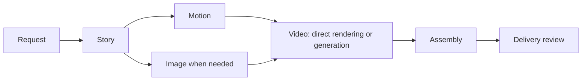

# Production workflow

Start with the requested output in `PROJECT.md`, under [project context](project-context.md). For a finished film, the tasks connect like this:

## At a glance

| Task | Receives | Produces |
| --- | --- | --- |
| [Story](../story/SKILL.md) | The request and adopted facts | The screenplay: what the audience sees and hears, including events, lines, cuts and sound |
| [Motion](../motion/SKILL.md) | The screenplay and [simple 3D subjects](../development/entities.md#coarse-first) | The motion hint: the performed action, staging, camera and timing |
| [Image](../image/SKILL.md) | Subject facts and the adopted look | Reusable appearance references; where needed, a shot frame made from a hint frame and those references |
| [Video](../video/SKILL.md) | The screenplay, reviewed performance and required images and [audio](../audio/SKILL.md) | Final picture: directly rendered scenes or accepted generated clips, called takes |
| [Assembly](assembly.md) | Programmed scenes or finished takes, with commissioned sound and captions | The complete video for [delivery review](../review/delivery-review.md) |

Motion supplies how things move; image supplies how they look. They can develop alongside each other, but a shot frame needs its motion-hint frame first.

Accept the performance on polygon people and coarse objects. Video then finishes the picture: direct rendering selects commissioned [entity detail options](../development/entities.md#detail); generation uses images and prompts to give the hint its look.

## Work order

For a generated film, choose the video model with the user under [video diffusion](../video/diffusion/SKILL.md) before preparing its images or rendering its inputs. Its accepted inputs determine what to make.

The [story route](../story/workflow/SKILL.md) sets how the screenplay is written. A short runs [brief](../story/layers/brief.md#what-it-holds) (shared subject facts) → screenplay. Long work develops settings → treatments → scripts → screenplay: world facts, events, performed scenes, then the final audiovisual plan.

The short route includes a programmed film draft before narrative review when a film is commissioned. Generate takes only after the [generation prerequisites](../video/generated-film.md#prerequisites) are met.

## Delivery paths

The [commissioned output](SKILL.md#commissioned-outputs) selects where the path ends:

- Screenplay only: finish at the text along its chosen story route.
- Whole motion hint: assemble and review the complete programmed film.
- Direct 3D film: finish the programmed film under [direct rendering](../video/direct-film.md), then assemble and review it.
- Generated film: generate and finish takes, then assemble and review the complete film.
- Standalone asset: follow its task and [asset review](../review/delivery-review.md#assets), without a story or film.
