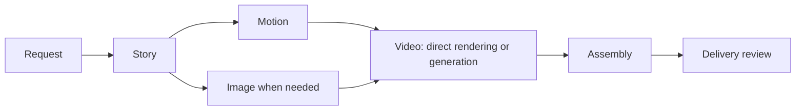

# Production workflow

## Handoffs

For a finished film, the tasks connect like this:

| Task | Receives | Hands on |
| --- | --- | --- |
| [Story](../story/SKILL.md) | The request and adopted facts | The screenplay |
| [Motion](../motion/SKILL.md) | The screenplay and simple 3D subjects | The motion hint |
| [Image](../image/SKILL.md) | Subject facts and the adopted look | Appearance references and shot frames |
| [Video](../video/SKILL.md) | The screenplay, the reviewed hint, images and audio | The final picture |
| [Assembly](assembly.md) | Programmed scenes or finished takes, sound and captions | The complete video |

The screenplay decides the events, dialogue, cuts and sound. The motion hint performs the action, staging, camera and timing on [simple 3D subjects](../development/entities.md#coarse-first).

Accept the coarse performance before finishing the picture. Direct rendering uses commissioned [detail options](../development/entities.md#detail). Generation uses the hint, images and prompts and produces takes.

Image can develop alongside motion, but a shot frame needs its motion-hint frame first.

Commissioned sound comes from [audio](../audio/SKILL.md).

## Order by output

### Screenplay

1. Record the commission in [project context](project-context.md).
2. Write the screenplay along its [story route](../story/workflow/SKILL.md).
3. Pass [delivery review](../review/delivery-review.md).

A short runs [brief](../story/layers/brief.md#what-it-holds) (shared subject facts) → screenplay. Long work develops settings → treatments → scripts → screenplay: world facts, events, performed scenes, then the final audiovisual plan.

### Whole motion hint

1. Record the commission in [project context](project-context.md).
2. Write the screenplay along its [story route](../story/workflow/SKILL.md).
3. Program the film in the [order](../motion/SKILL.md#order) motion sets.
4. Assemble the whole timeline under [assembly](assembly.md).
5. Pass [delivery review](../review/delivery-review.md).

On the short route, step 3 runs inside the route as a programmed film draft, before its narrative review.

### Direct 3D film

The whole motion hint's steps, with the film finished under [direct rendering](../video/direct-film.md) before assembly.

### Generated film

Run the whole motion hint's steps through step 3, then the [generated film](../video/generated-film.md) steps once its [prerequisites](../video/generated-film.md#prerequisites) are met. Assembly and delivery review follow on the finished takes.

Choose the model with the user under [video diffusion](../video/diffusion/SKILL.md) before preparing its inputs.

### Standalone asset

A standalone asset ends at [asset review](../review/delivery-review.md#assets).
