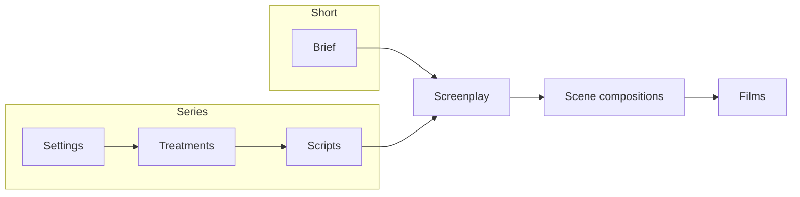

# Authoring chain

A production writes its screenplay through a chain of layers. Each layer makes its own decisions, cites the decisions of the layer above it by anchor, and hands usable decisions to the next. The code continues the same chain: entities realize the canon, scenes realize the screenplay, and films order the scenes. No scene exists without a written basis, and no decision goes unrealized, because the [evidence graph](/docs/screenplay/evidence-graph) fails on either.



## Two routes

The route depends on how far the story's causes reach:

| Route | Use for |
| --- | --- |
| Short: brief → screenplay | A film of a few minutes whose events fit one screenplay, including shorts that share a world |
| Long: settings → treatments → scripts → screenplay | Causes, setups and payoffs that span many scenes or releases: a series, a feature or an episode |

The agent records the route in `PROJECT.md`. In a workspace the production's folder fixes it: `movies/shorts/<name>` runs the short route and `movies/series/<name>` the long one.

## The layers

Every narrative document lives under `docs/body/`, one layer per folder:

| Layer | Location |
| --- | --- |
| Settings, long route | `docs/body/settings/<domain>/<subject>.md`, with `docs/body/settings/outline/index.md` as the finding guide |
| Brief, short route | `docs/body/brief/<domain>/<subject>.md` |
| Treatments | `docs/body/treatments/NNN-event.md` |
| Scripts | `docs/body/scripts/NNN-part/NNN-episode.md` |
| Screenplay | `docs/body/screenplay/<film>/NNN-<scene>.md`, or `NNN-part/NNN-episode/NNN-<scene>.md` on the long route |

### Settings and the brief

Settings and the brief own what later layers keep true. Each subject has one file in a domain such as `cast`, `crowds`, `props`, `sets`, `world`, `cinematography` or `sound`. The file uses an H1 for the subject, H2s for its facets and anchored H3s for its facts and decisions. A brief holds only the decisions that several scenes must keep, while settings hold the world's facts, baseline states, relationships and what each person knows.

### Treatments

Treatments decide the events: causes, choices, costs, results, setups and payoffs, and when the audience learns each fact relative to the characters. Each event file has one H1 and anchored H2s for its decisions, and cites the settings it changes or reveals.

### Scripts

Scripts partition the events into playable scenes and execute each one: dialogue, action, reactions, stage, light, sound and view. An episode file has an H1 for the episode and an anchored H2 per scene, and cites every treatment it realizes.

### Screenplay

The screenplay composes what the audience sees and hears, beat by beat, in one file per scene. It is the last place a decision is made; code only realizes it. On the long route each screenplay scene file realizes exactly one script scene. [Writing scenes](/docs/screenplay/writing-scenes) describes the format.

## How a layer cites its parent

A citation names the parent's file and anchor, so the graph can tell which decision a passage realizes. These are the citations each layer owes:

| Respondent | Cites |
| --- | --- |
| Settings, or a short or directly written screenplay | The `docs/instructions/` sections it adopts or realizes |
| Treatments | The settings facts and instruction sections they realize |
| A script episode | Each treatment event it realizes |
| A long screenplay scene file | The one script scene it realizes, and the treatments behind it |
| A short screenplay section | The brief decisions it keeps |
| A scene composition in `src/composition/scenes/` | Its screenplay scene file, or each section and beat it realizes |
| A film in `src/composition/films/` | Each scene file it plays, in order |

A script episode records its parents in an HTML comment above its first heading:

```markdown
<!--
@evidence docs/body/treatments/001-arrival.md Opens with the arrival.
@evidence docs/body/treatments/002-departure.md Ends with the departure.
-->
# First

## Arrival {#arrival}

The guest arrives.
```

Removing the second citation leaves the departure event realized by no script, and the check reports it.

## Research

A law written without a study invents the practice. The agent studies every practice and style the film shows when a decision first needs it, starting from how the practice is really performed, and writes the study under `docs/research/<discipline>/<topic>.md`. Studies hold the laws, limits and measurable targets that the screenplay and the motion code follow.

## The pass

Each layer is written as a pass. On the long route each layer's pass closes before the next layer builds on it:

1. Construction: the author finishes the whole layer and inspects and repairs it by cause.
2. Evidence: a separate answerer enables the layer's stage, writes the answers and returns the gaps it cannot answer truthfully.
3. Review: an independent reviewer reads the layer, its boundaries and its population.
4. Repair: the author decides each finding and repairs the accepted ones at their owners.

A long-route pass runs at most two review rounds. A round in which the author accepts no finding closes the pass. Otherwise a fresh reviewer reads the repaired layer once more, and the pass closes when that round's accepted findings are repaired.

A short drafts its brief, screenplay and any programmed film together. It then runs Evidence once and takes one independent review of the brief and screenplay, and the repairs reach the code as well.

## Repairs at the owner

A gap found downstream is repaired in the layer that owns it. A beat no composition of installed actions or cited law can perform is repaired in the screenplay, or at the parent that owns the decision, before code is written from it. A closed layer stays closed: later repairs owe no new story answers, and the next review reads a changed passage afresh.

Discovery runs once before bulk writing. It assigns each instruction and delegated choice to its owning layer and looks for requirements that no layer, study or contract covers yet. The long route repeats it after settings, before composition and after the output is reviewed. The result is recorded in `docs/contracts/work/discovery/results.md`.
